# Rapport de Travaux Pratiques : Sécurisation d'une architecture microservices Spring et Angular avec Keycloak

**Filière :** GLSID — Génie du Logiciel et des Systèmes Informatiques Distribués  
**Encadrant :** Mohamed YOUSSFI  
**Étudiant :** Youness HATTABI

---

## Table des matières

1. [Introduction](#1-introduction)
2. [Architecture générale](#2-architecture-générale)
3. [Partie 1 : Prise en main de Keycloak](#3-partie-1--prise-en-main-de-keycloak)
4. [Partie 2 : Sécurisation de l'architecture Spring et Angular](#4-partie-2--sécurisation-de-larchitecture-spring-et-angular)
5. [Tests et résultats](#5-tests-et-résultats)
6. [Conclusion](#6-conclusion)

---

## 1. Introduction

Dans une architecture distribuée, chaque application, y compris chaque microservice, doit savoir **qui** appelle ses ressources et **ce qu'il a le droit de faire**. Réimplémenter dans chaque projet la gestion des utilisateurs, des mots de passe, des rôles et des sessions est long et source de failles. Une solution consiste à confier l'identité à un serveur dédié et à faire circuler des **jetons signés** entre les applications.

**Keycloak** est un serveur d'identité et de gestion des accès open source. Il implémente les standards **OAuth 2.0** et **OpenID Connect** et délivre des **JWT** (_JSON Web Tokens_). Il fournit aussi la gestion des utilisateurs et des rôles, des pages d'authentification personnalisables, la fédération d'identités (LDAP, Active Directory) et l'authentification par des fournisseurs externes.

Ce travail pratique comporte deux parties :

- **Partie 1** : installer Keycloak, créer un _realm_, un client, des rôles et des utilisateurs, puis tester l'authentification en ligne de commande et analyser les jetons obtenus.
- **Partie 2** : sécuriser une application composée de deux microservices Spring Boot (`inventory-service` et `order-service`) et d'un front-end Angular, en s'appuyant sur le realm créé en partie 1.

## 2. Architecture générale

L'application contient trois composants à protéger, plus Keycloak qui joue le rôle de serveur d'autorisation.

| Composant           | Port   | Rôle                                                                |
| ------------------- | ------ | ------------------------------------------------------------------- |
| Keycloak            | `8080` | Authentification, émission des jetons, clés publiques de signature. |
| `inventory-service` | `8087` | Gestion des produits, ressource protégée.                           |
| `order-service`     | `8088` | Gestion des commandes, ressource protégée, appelle l'inventaire.    |
| `ecom-app-angular`  | `4200` | Interface Web, client public de Keycloak.                           |

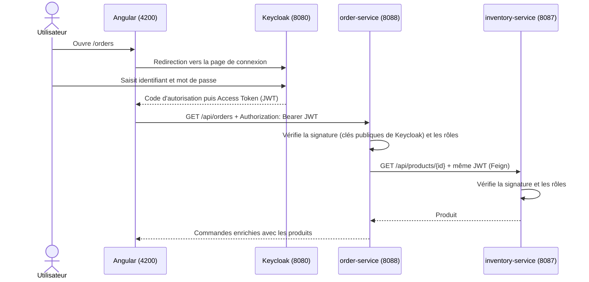

Le principe repose sur trois points :

1. Le front-end ne gère jamais le mot de passe : l'utilisateur est redirigé vers **Keycloak**, qui renvoie un **Access Token**.
2. Chaque microservice est un **Resource Server** : il valide la **signature** du JWT avec les clés publiques de Keycloak et en extrait les **rôles**. Il n'appelle pas Keycloak à chaque requête.
3. Lorsqu'un service en appelle un autre, il **relaie le jeton** reçu, afin que le second service connaisse aussi l'utilisateur d'origine.

## 3. Partie 1 : Prise en main de Keycloak

### 3.1. Téléchargement et démarrage

Keycloak est développé avec le framework Quarkus. Le sujet mentionne la version 19 ; la version utilisée ici est **Keycloak 26.8.2**, la version courante, dont les étapes sont identiques mais dont l'initialisation de l'administrateur a changé (voir 3.2).

L'archive est téléchargée depuis `keycloak.org/downloads` puis décompressée. Le serveur est lancé en mode développement, avec une base de données H2 sur fichier, suffisante pour un TP :

```powershell
cd C:\keycloak-26.8.2\keycloak-26.8.2\bin
$env:KC_BOOTSTRAP_ADMIN_USERNAME = "admin"
$env:KC_BOOTSTRAP_ADMIN_PASSWORD = "admin"
.\kc.bat start-dev
```

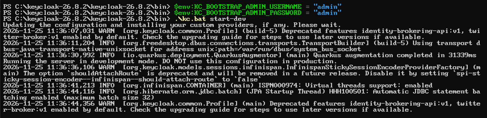

Le mode `start-dev` ne doit pas être utilisé en production. Dans ce cas, Keycloak se connecte à une vraie base de données (PostgreSQL, MySQL, MariaDB, Oracle, SQL Server), par exemple avec `--db=postgres --db-url=... --db-username=... --db-password=...`.

### 3.2. Création du compte administrateur

Depuis la version 26, le compte administrateur initial est créé à partir de deux **variables d'environnement**, `KC_BOOTSTRAP_ADMIN_USERNAME` et `KC_BOOTSTRAP_ADMIN_PASSWORD`, définies avant le démarrage (dans les anciennes versions, un formulaire s'affichait au premier accès). La console d'administration est ensuite accessible sur `http://localhost:8080` avec ce compte. Keycloak signale qu'il s'agit d'un administrateur temporaire, ce qui est acceptable pour un TP.

### 3.3. Création du realm

Un **realm** est le territoire à sécuriser : l'ensemble des utilisateurs, rôles et applications gérés ensemble, isolés des autres realms. Le realm créé est **`glsid3-realm`** (menu _Manage realms_, puis _Create realm_).

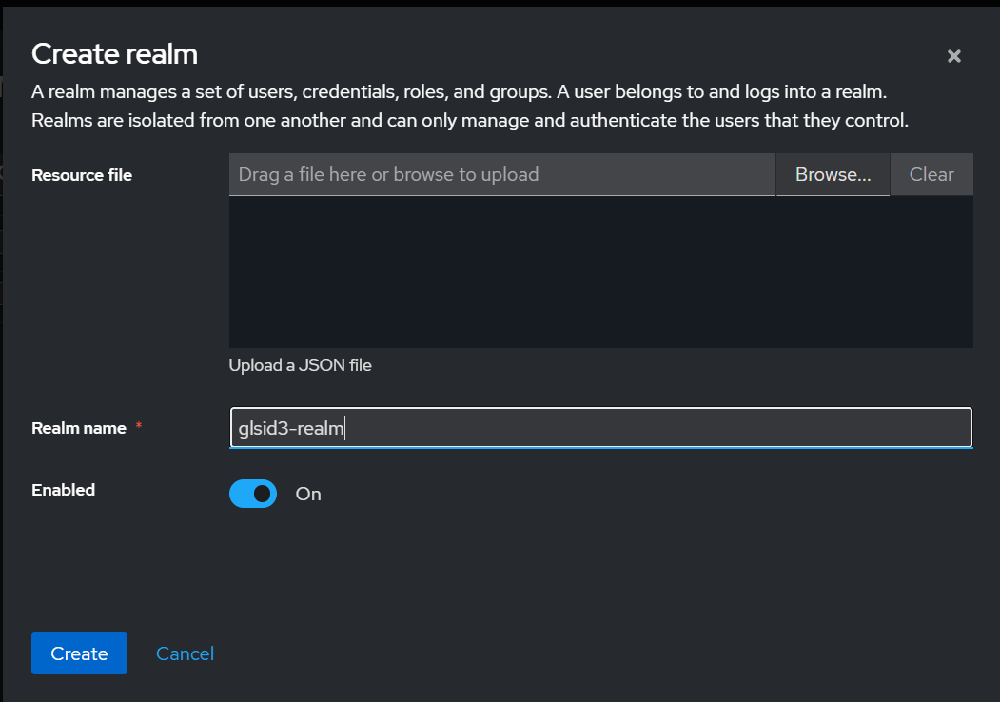

### 3.4. Création du client à sécuriser

Un **client** représente une application qui demande l'authentification d'un utilisateur. Un client `app-test` est créé pour les tests de la partie 1 :

| Paramètre             | Valeur                                                                     |
| --------------------- | -------------------------------------------------------------------------- |
| Client type           | OpenID Connect                                                             |
| Client ID             | `app-test`                                                                 |
| Client authentication | Off (client public)                                                        |
| Standard flow         | Activé                                                                     |
| Direct access grants  | Activé, ce qui autorise l'authentification par identifiant et mot de passe |

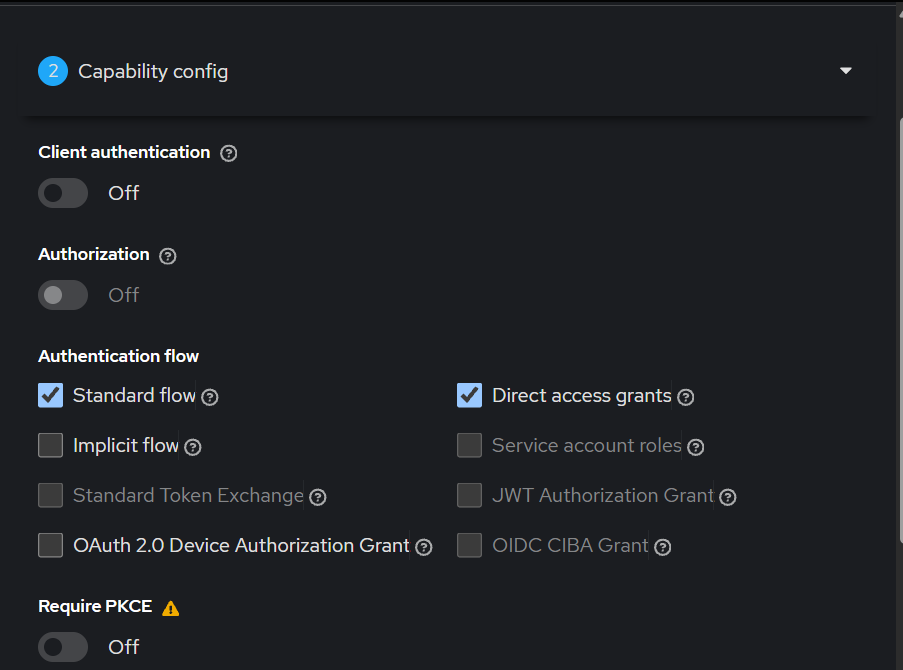

### 3.5. Création des rôles

Deux rôles de realm sont créés dans _Realm roles_ : `USER` et `ADMIN`.

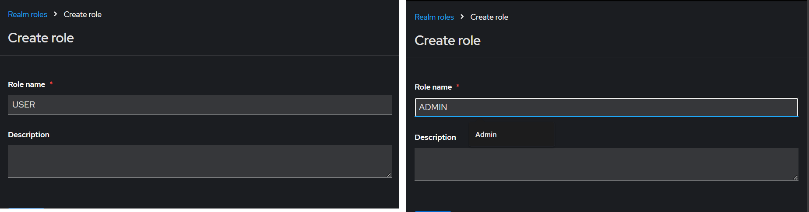

### 3.6. Création des utilisateurs

Deux utilisateurs sont créés dans _Users_. L'adresse e-mail, le prénom et le nom sont renseignés, car les versions récentes de Keycloak refusent la connexion d'un compte dont le profil est incomplet.

| Utilisateur | E-mail          | Prénom / Nom | Mot de passe |
| ----------- | --------------- | ------------ | ------------ |
| `user1`     | user1@gmail.com | User / One   | `1234`       |
| `user2`     | user2@gmail.com | User / Two   | `1234`       |

Le mot de passe est défini dans l'onglet _Credentials_ avec l'option _Temporary_ désactivée. Un mot de passe temporaire obligerait l'utilisateur à le changer à la première connexion, ce qui bloquerait les tests en ligne de commande.

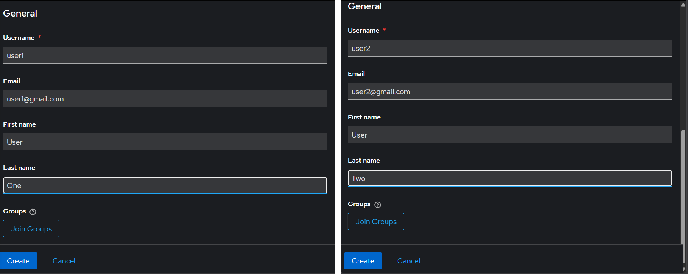

### 3.7. Affectation des rôles aux utilisateurs

Dans l'onglet _Role mapping_ de chaque utilisateur :

- `user1` reçoit le rôle `USER` ;
- `user2` reçoit les rôles `USER` et `ADMIN`.

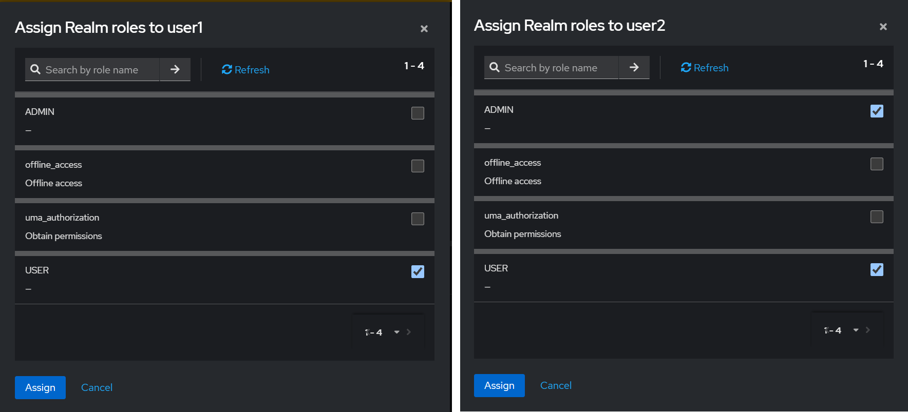

### 3.8. Tests d'authentification

Les tests sont réalisés avec `curl.exe` sous PowerShell, équivalent d'un client Postman. Dans PowerShell, `curl` seul est un alias de `Invoke-WebRequest`, d'où le suffixe `.exe`. L'URL du _token endpoint_ figure dans _Realm settings_, au lien _OpenID Endpoint Configuration_ :

```
POST http://localhost:8080/realms/glsid3-realm/protocol/openid-connect/token
Content-Type: application/x-www-form-urlencoded
```

Les paramètres sont envoyés sous la forme `clé=valeur` (`x-www-form-urlencoded`) et non en JSON.

#### a) Authentification avec identifiant et mot de passe (`grant_type=password`)

```powershell
$resp = curl.exe -s -X POST "http://localhost:8080/realms/glsid3-realm/protocol/openid-connect/token" `
  -H "Content-Type: application/x-www-form-urlencoded" `
  -d "grant_type=password" -d "client_id=app-test" -d "username=user1" -d "password=1234" | ConvertFrom-Json
$resp
```

La réponse contient un `access_token` valable **300 secondes** (`expires_in`), et un `refresh_token` valable **1800 secondes** (`refresh_expires_in`).

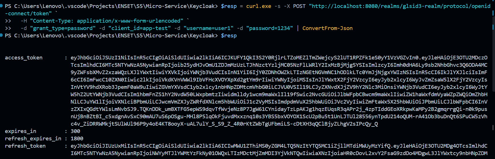

#### b) Analyse des deux jetons JWT

Les jetons sont décodés localement avec une petite fonction PowerShell (jwt.io permet aussi de le faire en ligne) :

```powershell
function Show-Jwt($jwt) {
  $p = $jwt.Split('.')[1].Replace('-','+').Replace('_','/')
  $p = $p.PadRight($p.Length + (4 - $p.Length % 4) % 4, '=')
  [Text.Encoding]::UTF8.GetString([Convert]::FromBase64String($p)) | ConvertFrom-Json
}
Show-Jwt $resp.access_token
Show-Jwt $resp.refresh_token
```

**Access Token.** Il est signé avec l'algorithme asymétrique RSA, ce qui permet à n'importe quel service de vérifier la signature avec la clé publique de Keycloak sans connaître de secret. Il contient les informations nécessaires aux applications :

| Claim                                               | Signification                                                            |
| --------------------------------------------------- | ------------------------------------------------------------------------ |
| `exp`, `iat`                                        | Dates d'expiration et d'émission, écart de 300 secondes.                 |
| `jti`                                               | Identifiant unique du jeton.                                             |
| `iss`                                               | Émetteur : `http://localhost:8080/realms/glsid3-realm`.                  |
| `sub`                                               | Identifiant de l'utilisateur authentifié.                                |
| `typ`                                               | `Bearer`.                                                                |
| `azp`                                               | Client à l'origine de la demande : `app-test`.                           |
| `realm_access`                                      | Rôles de realm de l'utilisateur ; c'est ce que lisent les microservices. |
| `preferred_username`, `name`, `given_name`, `email` | Informations de profil.                                                  |

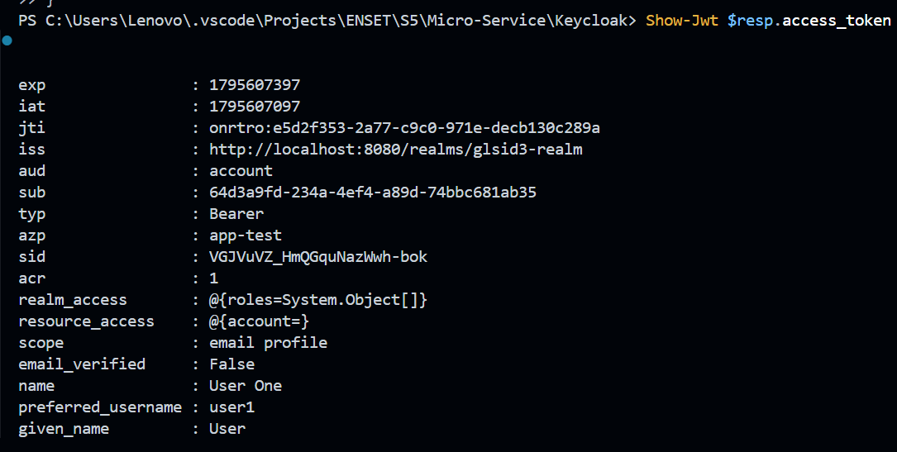

**Refresh Token.** Il sert uniquement à obtenir de nouveaux jetons. Il contient seulement des informations techniques : dates d'expiration (écart de 1800 secondes), identifiants, `typ` égal à `Refresh`, mais **aucun rôle ni profil**, car il n'a pas vocation à être transmis aux services métier.

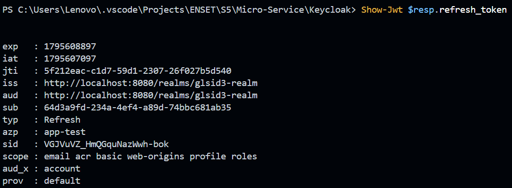

#### c) Authentification avec le Refresh Token (`grant_type=refresh_token`)

Aucun identifiant ni mot de passe n'est renvoyé. Le jeton de rafraîchissement suffit à obtenir un nouveau couple de jetons :

```powershell
curl.exe -s -X POST "http://localhost:8080/realms/glsid3-realm/protocol/openid-connect/token" `
  -H "Content-Type: application/x-www-form-urlencoded" `
  -d "grant_type=refresh_token" -d "client_id=app-test" -d "refresh_token=$($resp.refresh_token)"
```

#### d) Authentification avec Client ID et Client Secret (`grant_type=client_credentials`)

Ce mode sert à l'authentification entre services, sans utilisateur. Dans le client `app-test`, **Client authentication** est activé et **Service accounts roles** est coché. Keycloak génère alors un secret, visible dans l'onglet _Credentials_.

```powershell
curl.exe -s -X POST "http://localhost:8080/realms/glsid3-realm/protocol/openid-connect/token" `
  -H "Content-Type: application/x-www-form-urlencoded" `
  -d "grant_type=client_credentials" -d "client_id=app-test" -d "client_secret=<SECRET>"
```

La réponse contient un Access Token, sans Refresh Token (`refresh_expires_in` vaut `0`). Une fois l'authentification du client activée, les autres modes (mot de passe, refresh token) exigent eux aussi le `client_secret`.

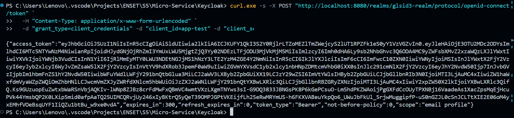

> Dans cette capture, le secret du client a été masqué.

#### e) Modification de la durée de vie des jetons

Les durées par défaut sont de 5 minutes pour l'Access Token et de 30 minutes pour le Refresh Token. L'Access Token se règle dans _Realm settings → Tokens → Access Token Lifespan_, et la durée de session associée au Refresh Token dans _Realm settings → Sessions_. Après avoir ramené l'Access Token à 60 secondes, un nouveau jeton est demandé : `expires_in` vaut bien **60**.

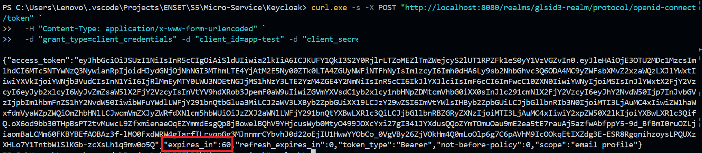

## 4. Partie 2 : Sécurisation de l'architecture Spring et Angular

### 4.1. Choix des versions

| Composant        | Version                                     | Remarque                                                           |
| ---------------- | ------------------------------------------- | ------------------------------------------------------------------ |
| Java             | 21                                          |                                                                    |
| Spring Boot      | 3.5.x                                       | Spring Security _Resource Server_.                                 |
| Spring Cloud     | 2025.0.3                                    | Uniquement pour OpenFeign.                                         |
| springdoc        | `springdoc-openapi-starter-webmvc-ui` 2.8.x | Swagger UI sur `order-service`.                                    |
| Keycloak         | 26.8.2                                      |                                                                    |
| Angular          | Version courante, composants _standalone_   |                                                                    |
| keycloak-angular | Même version majeure qu'Angular             | API fonctionnelle `provideKeycloak`.                               |
| keycloak-js      | 26                                          | Même version que le serveur, comme le recommande la documentation. |

Les dépendances Spring Cloud Config et Eureka du projet d'origine ne sont pas utilisées ici : le sujet les désactivait déjà, et elles reviennent avec les étapes Discovery et Gateway.

### 4.2. Client Keycloak pour Angular

Un second client, `ecom-client-ang`, est créé pour le front-end. C'est un **client public** : une application Angular s'exécute dans le navigateur et ne peut pas garder un secret.

| Paramètre                       | Valeur                                                           |
| ------------------------------- | ---------------------------------------------------------------- |
| Client ID                       | `ecom-client-ang`                                                |
| Client authentication           | Off                                                              |
| Standard flow                   | Activé                                                           |
| Direct access grants            | Activé (utilisé pour les tests en ligne de commande)             |
| Valid redirect URIs             | `http://localhost:4200/*`                                        |
| Valid post logout redirect URIs | `http://localhost:4200/*`                                        |
| Web origins                     | `http://localhost:4200`, nécessaire pour éviter les erreurs CORS |

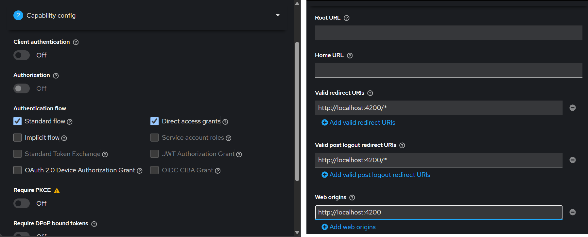

### 4.3. Microservice `inventory-service`

Les packages suivent la forme `hattabi.youness.inventoryservice`. Le service expose les produits (entité JPA `Product`, base H2 en mémoire, trois produits insérés au démarrage) et devient un _Resource Server_ OAuth2 grâce à la dépendance `spring-boot-starter-oauth2-resource-server`.

**`application.properties`**

```properties
spring.application.name=inventory-service
server.port=8087

spring.datasource.url=jdbc:h2:mem:products-db
spring.h2.console.enabled=true

spring.security.oauth2.resourceserver.jwt.issuer-uri=http://localhost:8080/realms/glsid3-realm
spring.security.oauth2.resourceserver.jwt.jwk-set-uri=http://localhost:8080/realms/glsid3-realm/protocol/openid-connect/certs
```

`jwk-set-uri` indique où récupérer les clés publiques pour vérifier la signature ; `issuer-uri` permet de vérifier que le jeton a bien été émis par le realm attendu.

**Conversion des rôles : `JwtAuthConverter`.** Par défaut, Spring lit les autorisations dans le claim `scope`. Keycloak place les rôles dans `realm_access.roles`. Ce convertisseur les transforme en autorités Spring :

```java
@Component
public class JwtAuthConverter implements Converter<Jwt, AbstractAuthenticationToken> {

    private final JwtGrantedAuthoritiesConverter defaultConverter = new JwtGrantedAuthoritiesConverter();

    @Override
    public AbstractAuthenticationToken convert(Jwt jwt) {
        Collection<GrantedAuthority> authorities = Stream.concat(
                defaultConverter.convert(jwt).stream(),
                extractRealmRoles(jwt).stream()
        ).collect(Collectors.toSet());
        return new JwtAuthenticationToken(jwt, authorities, jwt.getClaim("preferred_username"));
    }

    @SuppressWarnings("unchecked")
    private Collection<GrantedAuthority> extractRealmRoles(Jwt jwt) {
        Map<String, Object> realmAccess = jwt.getClaim("realm_access");
        if (realmAccess == null || realmAccess.get("roles") == null) {
            return Set.of();
        }
        Collection<String> roles = (Collection<String>) realmAccess.get("roles");
        return roles.stream().map(SimpleGrantedAuthority::new).collect(Collectors.toSet());
    }
}
```

**Configuration de sécurité : `SecurityConfig`.**

```java
@Configuration
@EnableWebSecurity
@EnableMethodSecurity
public class SecurityConfig {

    private final JwtAuthConverter jwtAuthConverter;

    public SecurityConfig(JwtAuthConverter jwtAuthConverter) {
        this.jwtAuthConverter = jwtAuthConverter;
    }

    @Bean
    SecurityFilterChain securityFilterChain(HttpSecurity http) throws Exception {
        return http
                .cors(Customizer.withDefaults())
                .sessionManagement(sm -> sm.sessionCreationPolicy(SessionCreationPolicy.STATELESS))
                .csrf(csrf -> csrf.disable())
                .headers(h -> h.frameOptions(fo -> fo.disable()))
                .authorizeHttpRequests(ar -> ar
                        .requestMatchers("/h2-console/**").permitAll()
                        .anyRequest().authenticated())
                .oauth2ResourceServer(o2 -> o2.jwt(jwt -> jwt.jwtAuthenticationConverter(jwtAuthConverter)))
                .build();
    }

    @Bean
    CorsConfigurationSource corsConfigurationSource() {
        CorsConfiguration configuration = new CorsConfiguration();
        configuration.setAllowedOrigins(List.of("http://localhost:4200"));
        configuration.setAllowedMethods(List.of("*"));
        configuration.setAllowedHeaders(List.of("*"));
        configuration.setExposedHeaders(List.of("*"));
        UrlBasedCorsConfigurationSource source = new UrlBasedCorsConfigurationSource();
        source.registerCorsConfiguration("/**", configuration);
        return source;
    }
}
```

- `STATELESS` : aucune session serveur, chaque requête porte son jeton.
- `csrf` désactivé : sans session ni cookie d'authentification, l'attaque CSRF ne s'applique pas.
- `@EnableMethodSecurity` : active les annotations `@PreAuthorize` sur les méthodes.
- Le CORS autorise uniquement l'origine du front-end, `http://localhost:4200`.

**Contrôleur : droits par rôle.**

```java
@RestController
@RequestMapping("/api")
public class ProductRestController {

    private final ProductRepository productRepository;

    public ProductRestController(ProductRepository productRepository) {
        this.productRepository = productRepository;
    }

    @GetMapping("/products")
    @PreAuthorize("hasAuthority('ADMIN')")
    public List<Product> productList() {
        return productRepository.findAll();
    }

    @GetMapping("/products/{id}")
    @PreAuthorize("hasAuthority('USER')")
    public Product productById(@PathVariable String id) {
        return productRepository.findById(id).orElseThrow();
    }

    @GetMapping("/auth")
    public Authentication authentication(Authentication authentication) {
        return authentication;
    }
}
```

La liste complète des produits est réservée à `ADMIN`, la consultation d'un produit par identifiant à `USER`. Le point `/api/auth` renvoie l'objet d'authentification et permet de contrôler les autorités reconnues par Spring.

### 4.4. Microservice `order-service`

`order-service` gère les commandes (`Order`, `ProductItem`, états `PENDING`, `CONFIRMED`, `CANCELED`, `EXECUTED`). Il utilise la même configuration de sécurité que `inventory-service` (mêmes `JwtAuthConverter` et `SecurityConfig`, avec en plus les chemins Swagger autorisés) et les mêmes propriétés `issuer-uri` et `jwk-set-uri`, sur le port `8088`.

Pour afficher le nom du produit de chaque ligne de commande, il interroge `inventory-service` avec **OpenFeign**. Comme ce service est protégé, l'appel doit contenir un jeton. Un intercepteur Feign **relaie le jeton de l'utilisateur** courant :

```java
@FeignClient(name = "inventory-service", url = "http://localhost:8087")
public interface InventoryRestClient {

    @GetMapping("/api/products")
    List<Product> getAllProducts();

    @GetMapping("/api/products/{id}")
    Product findProductById(@PathVariable("id") String id);
}
```

```java
@Component
public class FeignInterceptor implements RequestInterceptor {

    @Override
    public void apply(RequestTemplate template) {
        Authentication authentication = SecurityContextHolder.getContext().getAuthentication();
        if (authentication instanceof JwtAuthenticationToken jwtAuth) {
            template.header("Authorization", "Bearer " + jwtAuth.getToken().getTokenValue());
        }
    }
}
```

Sans cet intercepteur, `order-service` appellerait l'inventaire sans jeton et recevrait une erreur 401.

Le contrôleur complète chaque ligne de commande avec le produit correspondant :

```java
@GetMapping("/orders")
public List<Order> findAllOrders() {
    List<Order> orders = orderRepository.findAll();
    orders.forEach(o -> o.getProductItems().forEach(pi ->
            pi.setProduct(inventoryRestClient.findProductById(pi.getProductId()))));
    return orders;
}
```

Les données de démonstration des commandes référencent directement les identifiants `P01`, `P02` et `P03`. Au démarrage, aucun utilisateur n'est connecté, donc aucun jeton ne peut être relayé : l'application ne peut pas interroger l'inventaire à ce moment-là.

### 4.5. Front-end Angular

L'application utilise des composants _standalone_, des _signals_ et l'API fonctionnelle de `keycloak-angular`.

```powershell
npm install bootstrap keycloak-angular keycloak-js@26
```

Le fichier `silent-check-sso.html` est placé dans le dossier des ressources statiques ; il permet à `keycloak-js` de vérifier silencieusement l'existence d'une session SSO.

**Initialisation de Keycloak (`app.config.ts`).**

```ts
const apiCondition = createInterceptorCondition<IncludeBearerTokenCondition>({
  urlPattern: /^http:\/\/localhost:(8087|8088)(\/.*)?$/i,
});

export const appConfig: ApplicationConfig = {
  providers: [
    provideRouter(routes),
    provideKeycloak({
      config: {
        url: "http://localhost:8080",
        realm: "glsid3-realm",
        clientId: "ecom-client-ang",
      },
      initOptions: {
        onLoad: "check-sso",
        silentCheckSsoRedirectUri:
          window.location.origin + "/silent-check-sso.html",
      },
      features: [
        withAutoRefreshToken({
          onInactivityTimeout: "logout",
          sessionTimeout: 300000,
        }),
      ],
      providers: [AutoRefreshTokenService, UserActivityService],
    }),
    {
      provide: INCLUDE_BEARER_TOKEN_INTERCEPTOR_CONFIG,
      useValue: [apiCondition],
    },
    provideHttpClient(withInterceptors([includeBearerTokenInterceptor])),
  ],
};
```

- `check-sso` : l'application se charge sans connexion obligatoire. La redirection vers Keycloak n'a lieu que si l'utilisateur ouvre une route protégée.
- `includeBearerTokenInterceptor` : ajoute automatiquement `Authorization: Bearer <jeton>` aux appels vers les ports `8087` et `8088`, et uniquement vers eux.
- `withAutoRefreshToken` : renouvelle l'Access Token avant son expiration.

**Protection des routes.** Une garde fonctionnelle vérifie l'authentification, puis le rôle exigé par la route :

```ts
const isAccessAllowed = async (
  route: ActivatedRouteSnapshot,
  state: RouterStateSnapshot,
  authData: AuthGuardData,
): Promise<boolean | UrlTree> => {
  const router = inject(Router);
  const { authenticated, grantedRoles, keycloak } = authData;

  if (!authenticated) {
    await keycloak.login({ redirectUri: window.location.origin + state.url });
    return false;
  }
  const requiredRole: string | undefined = route.data["role"];
  if (!requiredRole || grantedRoles.realmRoles.includes(requiredRole)) {
    return true;
  }
  return router.parseUrl("/");
};

export const canActivateAuthRole =
  createAuthGuard<CanActivateFn>(isAccessAllowed);
```

```ts
export const routes: Routes = [
  {
    path: "products",
    component: ProductsComponent,
    canActivate: [canActivateAuthRole],
    data: { role: "ADMIN" },
  },
  {
    path: "customers",
    component: CustomersComponent,
    canActivate: [canActivateAuthRole],
    data: { role: "USER" },
  },
  {
    path: "orders",
    component: OrdersComponent,
    canActivate: [canActivateAuthRole],
    data: { role: "USER" },
  },
  {
    path: "order-details/:id",
    component: OrderDetailsComponent,
    canActivate: [canActivateAuthRole],
    data: { role: "USER" },
  },
];
```

**Interface.** La barre de navigation affiche le nom de l'utilisateur connecté et les boutons _Login_ et _Logout_. Le menu _Products_ n'apparaît que pour les utilisateurs ayant le rôle `ADMIN`. Ce masquage est seulement cosmétique : la protection réelle est assurée par la garde de route côté navigateur et, surtout, par `@PreAuthorize` côté serveur.

Les pages _Orders_ et _Order Details_ appellent `http://localhost:8088/api/orders`, la page _Products_ appelle `http://localhost:8087/api/products`.

## 5. Tests et résultats

### 5.1. Procédure de lancement

Ordre de démarrage : Keycloak, `inventory-service`, `order-service`, puis Angular.

```powershell
# Keycloak
.\kc.bat start-dev

# Microservices (un terminal par service)
.\mvnw.cmd spring-boot:run

# Front-end
ng serve
```

### 5.2. Tests en ligne de commande des microservices

| Test                                    | Utilisateur | Résultat obtenu                                                      |
| --------------------------------------- | ----------- | -------------------------------------------------------------------- |
| `GET :8087/api/products` sans jeton     | aucun       | **401 Unauthorized**                                                 |
| `GET :8087/api/products` avec jeton     | `user1`     | **403 Forbidden** (`insufficient_scope`), il n'a pas le rôle `ADMIN` |
| `GET :8087/api/products/P01` avec jeton | `user1`     | **200 OK**, il a le rôle `USER`                                      |
| `GET :8087/api/products` avec jeton     | `user2`     | **200 OK**, il a le rôle `ADMIN`                                     |
| `GET :8088/api/orders` avec jeton       | valide      | **200 OK**, commandes enrichies par les produits de l'inventaire     |

Sans jeton, la requête est rejetée (401). Avec un jeton valide mais sans le rôle exigé, elle est refusée (403). Cela distingue bien l'**authentification** (qui es-tu ?) de l'**autorisation** (qu'as-tu le droit de faire ?).

**Sans jeton :**

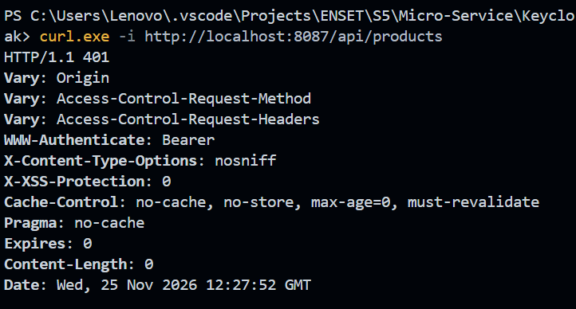

**`user1` demande la liste des produits (réservée à `ADMIN`) :**

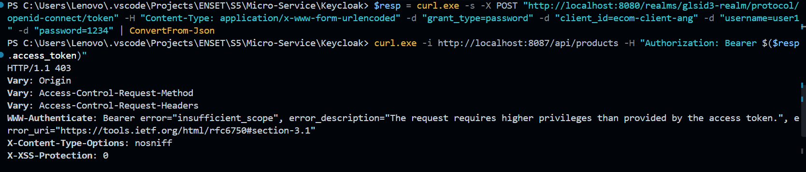

**`user1` demande un produit par identifiant :**

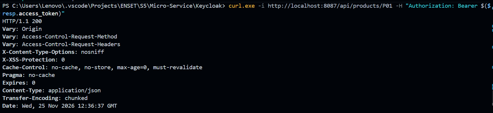

**`user2` demande la liste des produits :**

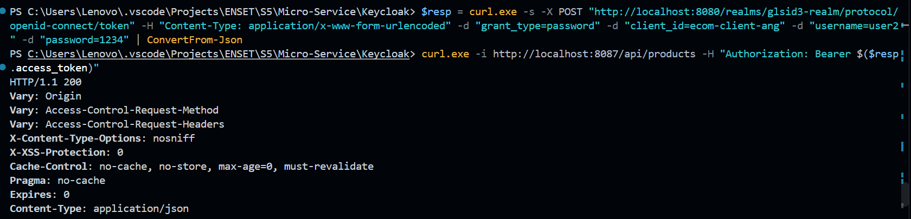

**`order-service` avec un jeton valide :**

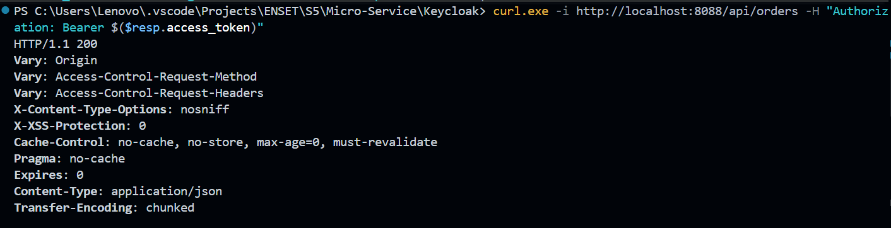

### 5.3. Tests de l'application Angular

Le parcours suivant est réalisé dans le navigateur :

1. `http://localhost:4200` s'ouvre sans connexion (`check-sso`).
2. Le clic sur _Orders_ redirige vers la page de connexion du realm `glsid3-realm`.
3. Après la saisie de `user1` et de son mot de passe, l'utilisateur est renvoyé vers la liste des commandes.
4. L'utilisateur ouvre le détail d'une commande.
5. La déconnexion, puis la connexion avec `user2`, fait apparaître le menu _Products_.

**Page de connexion Keycloak :**

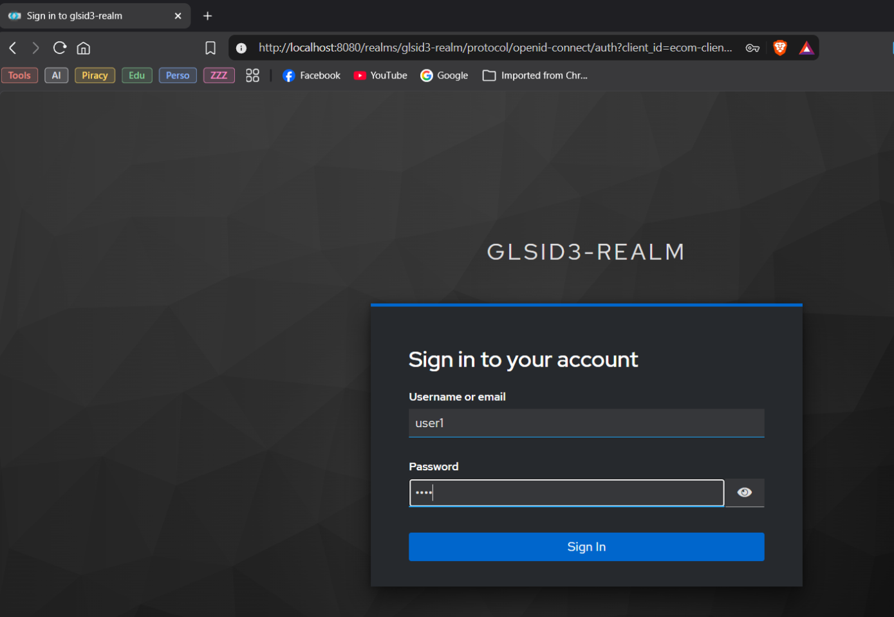

**Liste des commandes pour `user1`.** Le menu ne contient que _Customers_ et _Orders_ :

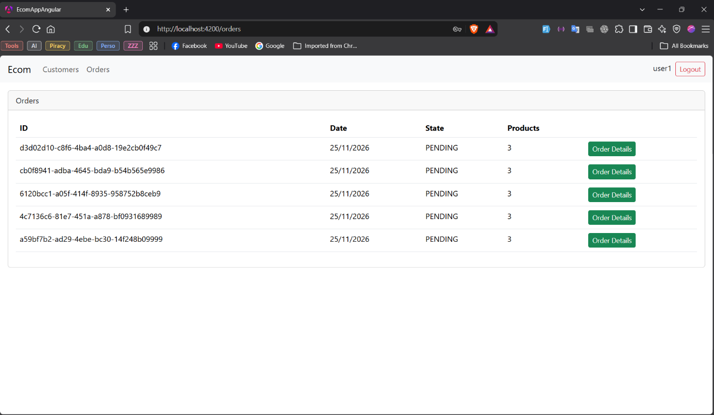

**Détail d'une commande.** Les noms de produits proviennent d'`inventory-service`, ce qui confirme que `order-service` relaie bien le jeton à l'inventaire. Le total est la somme des montants (quantité multipliée par prix) :

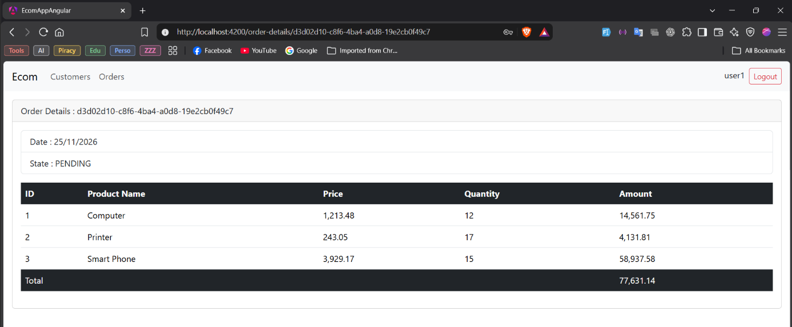

**Liste des produits pour `user2` (rôle `ADMIN`) :**

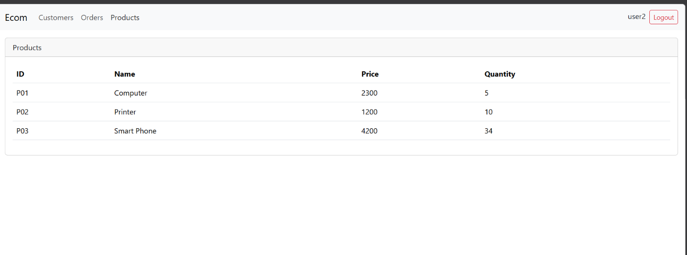

**Requête envoyée par Angular.** L'en-tête `Authorization: Bearer ...` est ajouté automatiquement à l'appel vers `order-service` :

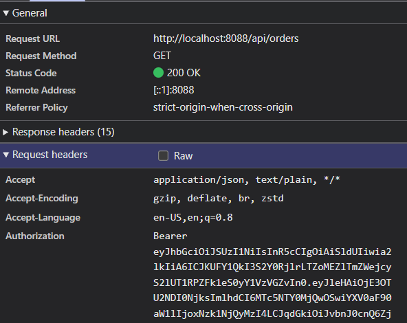

## 6. Conclusion

Ce travail pratique a montré comment déléguer l'authentification d'une architecture distribuée à un serveur d'identité standard. La première partie a permis de prendre en main Keycloak : création d'un realm, d'un client, de rôles et d'utilisateurs, puis obtention et analyse de jetons selon trois modes (mot de passe, refresh token, client credentials) et réglage de leur durée de vie.

La seconde partie a appliqué ces notions à une application complète. Les microservices Spring Boot valident la signature des JWT et appliquent les droits d'accès par rôle, avec un 401 sans jeton et un 403 pour un rôle insuffisant. Le jeton est relayé d'un service à l'autre avec OpenFeign, et le front-end Angular délègue la connexion à Keycloak, protège ses routes par rôle et joint automatiquement le jeton à ses requêtes.

Cette approche évite de développer et de maintenir un système d'authentification dans chaque application. Keycloak offre en plus, sans développement supplémentaire, des fonctions déjà vues en cours : politique de mots de passe, authentification à deux facteurs (OTP), inscription des utilisateurs, fédération avec un annuaire LDAP ou Active Directory, et connexion via des fournisseurs externes.

---
